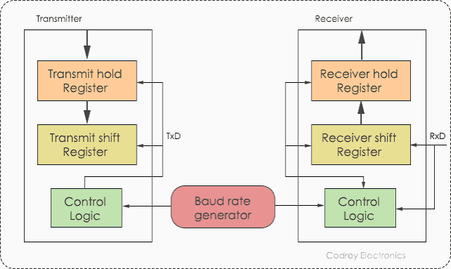
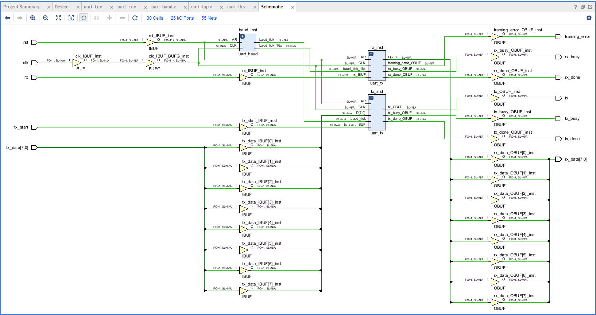
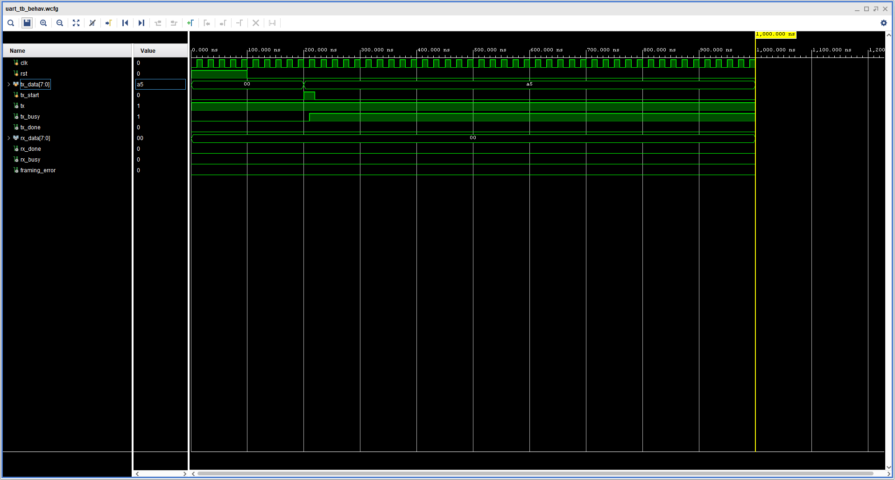

# UART Communication Protocol – RTL Design Using Verilog HDL

## 1. Project Overview

This project focuses on the RTL design and implementation of the UART (Universal Asynchronous Receiver/Transmitter) communication protocol using Verilog HDL.

The design consists of independent transmitter and receiver modules, a baud rate generator and a top-level integration module.

The project explores serial data transmission, reception, timing control, FSM-based architecture and functional simulation.

## 2. UART Architecture

UART is an asynchronous serial communication protocol that transfers data between devices using two communication signals:

- TX – Transmit data
- RX – Receive data

Unlike synchronous protocols, UART does not require a shared clock between communicating devices. Both devices must be configured with compatible baud rates.

### Architecture Diagram



### Circuit Diagram



## 3. RTL Design Architecture

The design is divided into four main modules.

| Module | Description |
|---|---|
| `uart_tx.v` | Serial data transmission |
| `uart_rx.v` | Serial data reception |
| `uart_baud.v` | Baud rate timing generation |
| `uart_top.v` | Integration of UART modules |

### UART Transmitter (TX)

- Accepts parallel input data.
- Generates UART start, data and stop bits.
- Uses an FSM to control transmission.
- Converts parallel data into serial output.

### UART Receiver (RX)

- Detects the incoming start bit.
- Samples incoming serial data.
- Reconstructs the received parallel data.
- Identifies reception completion.

### Baud Rate Generator

- Generates timing pulses for UART communication.
- Controls the transmission and reception timing.
- Provides the required baud rate reference.

### Top-Level Module

Integrates the transmitter, receiver and baud rate generator into a complete UART design.

## 4. UART Data Frame

A standard 8-bit UART frame consists of:

- 1 Start bit (Logic 0)
- 8 Data bits
- 1 Stop bit (Logic 1)


## 5. Simulation and Waveform Analysis

A basic Verilog testbench is developed to simulate the UART design and observe its transmission and reception behaviour.

**Testbench:** `uart_tb.v`

The simulation is used to examine:

- Serial data transmission.
- Serial data reception.
- TX and RX timing behaviour.
- Data integrity between transmitter and receiver.

### Simulation Waveform



## 6. Vivado Design Analysis

The RTL design can be examined using Xilinx Vivado to understand the synthesized hardware structure and connectivity.

Add your actual Vivado synthesized schematic screenshot here:

<!-- Replace with your actual synthesized schematic image -->

## 7. Project Files

```text
uart_communication_protocol/
│
├── uart_tx.v
├── uart_rx.v
├── uart_baud.v
├── uart_top.v
├── uart_tb.v
│
├── Images/
│   ├── architecture_uart.png
│   ├── uart_circuit_diagram.png
│   ├── uart_power.png
│   └── uart_waveform.png
│
└── README.md
```

## 8. Tools and Technologies

- Verilog HDL
- Xilinx Vivado
- Icarus Verilog
- GTKWave
- Ubuntu Linux
- Git and GitHub

## 9. Learning Outcomes

- Understanding asynchronous serial communication.
- Developing modular RTL architectures.
- Implementing FSM-based sequential logic.
- Understanding baud rate generation and timing control.
- Developing Verilog testbenches.
- Analysing RTL simulation waveforms.
- Exploring RTL synthesis using Vivado.

## 10. Future Work

- Develop a SystemVerilog-based verification environment.
- Implement functional checking and self-checking testbenches.
- Develop a UVM-based verification environment.
- Explore functional coverage and additional UART test scenarios.

## Author

**Dharaneeswaran A.**

B.E. Electronics and Communication Engineering

**Technical Interests:** Digital VLSI | RTL Design | SystemVerilog | Design Verification

- GitHub: https://github.com/dharaneesh-vlsi
- LinkedIn: https://www.linkedin.com/in/dharaneeswaran-a-b630572bb

---

*This project is part of my continuous learning journey in Digital VLSI and RTL Design.*
